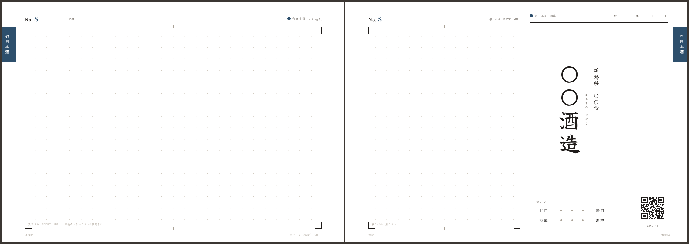
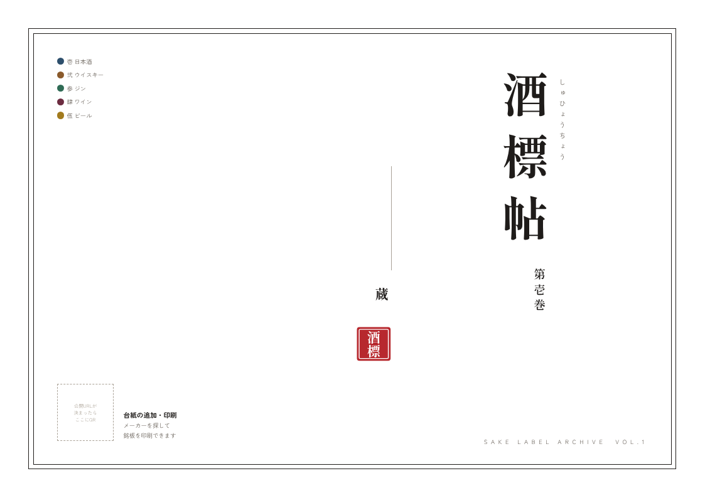
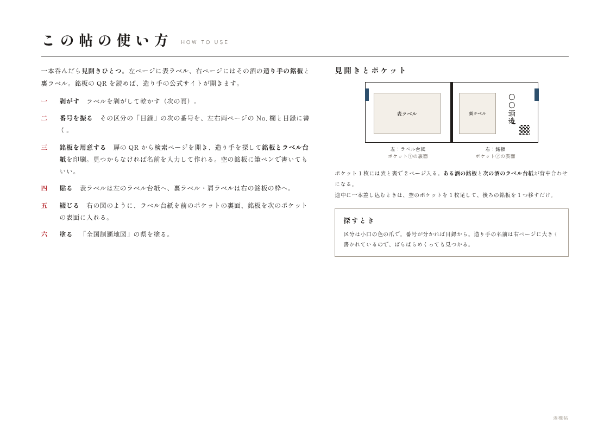
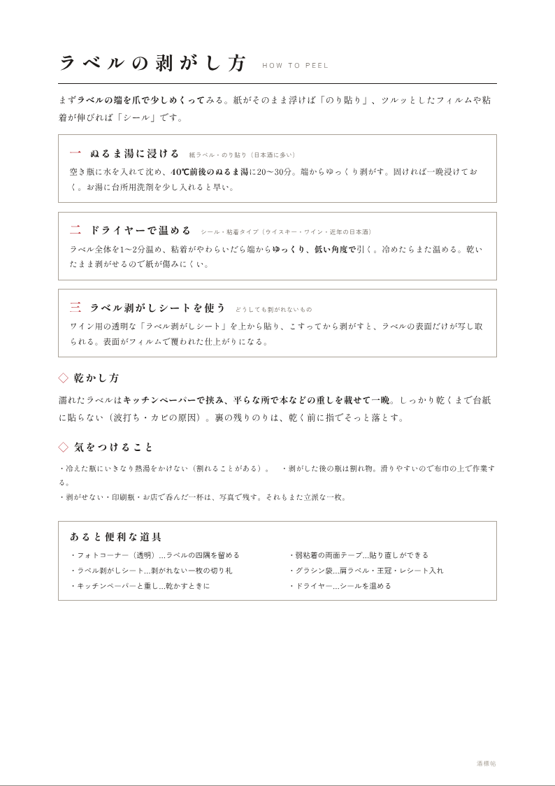
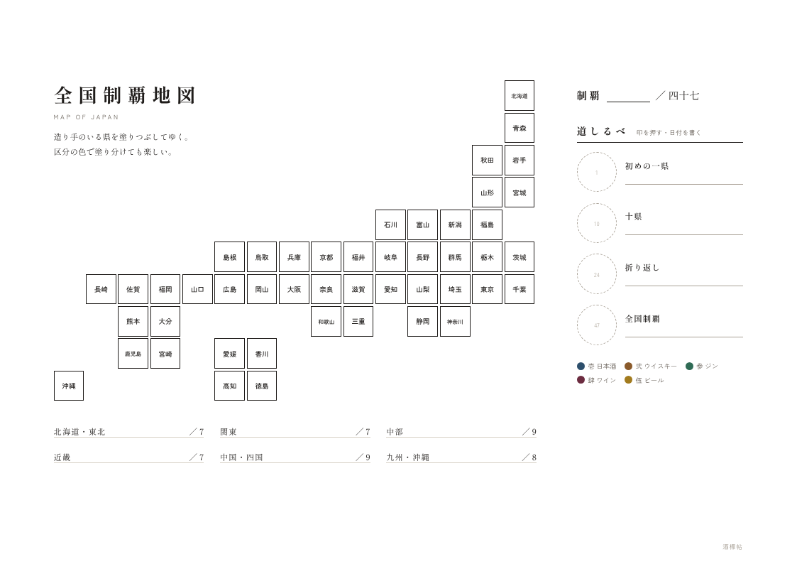
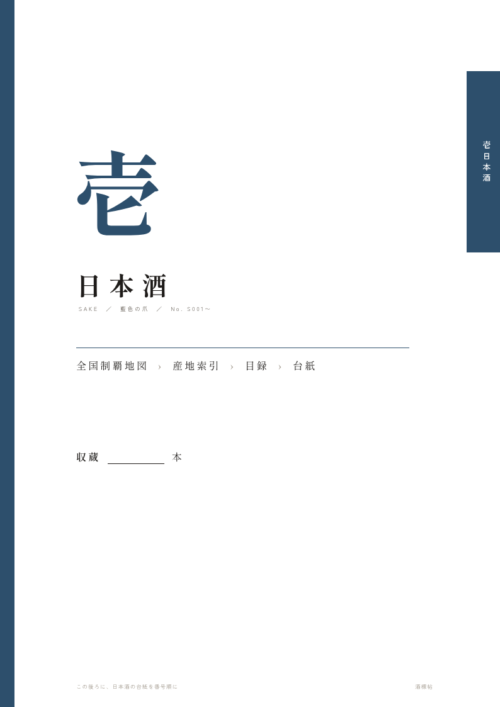
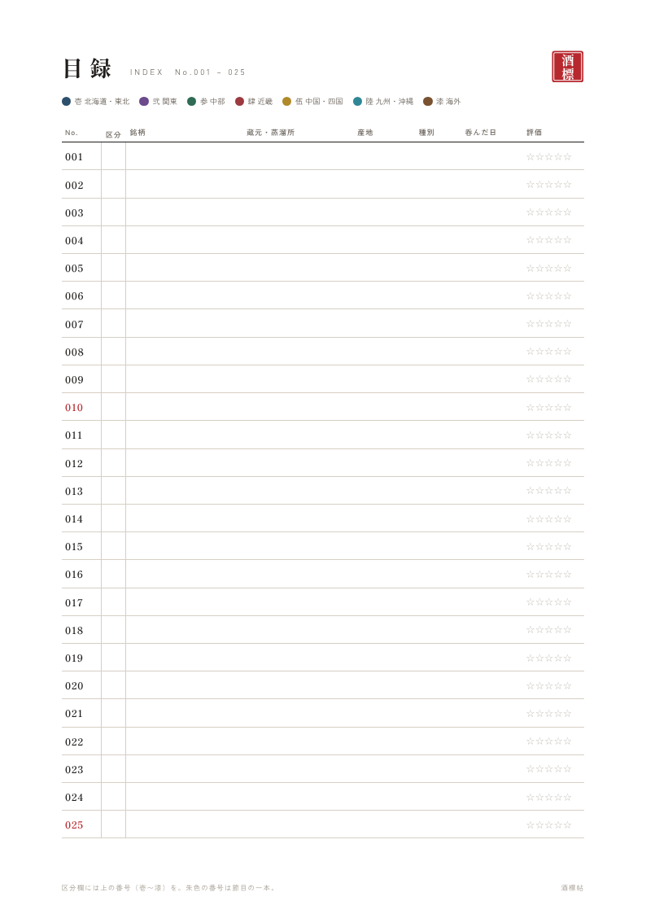
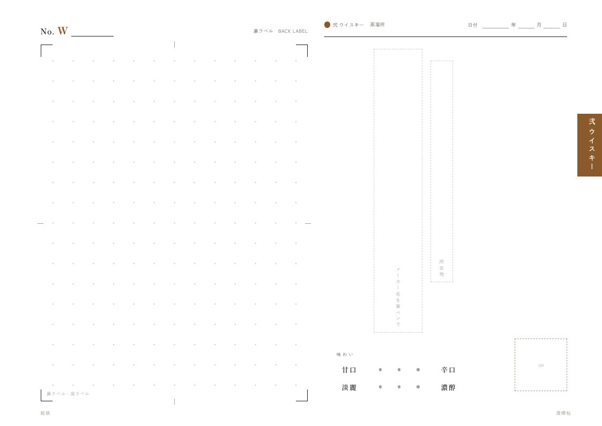
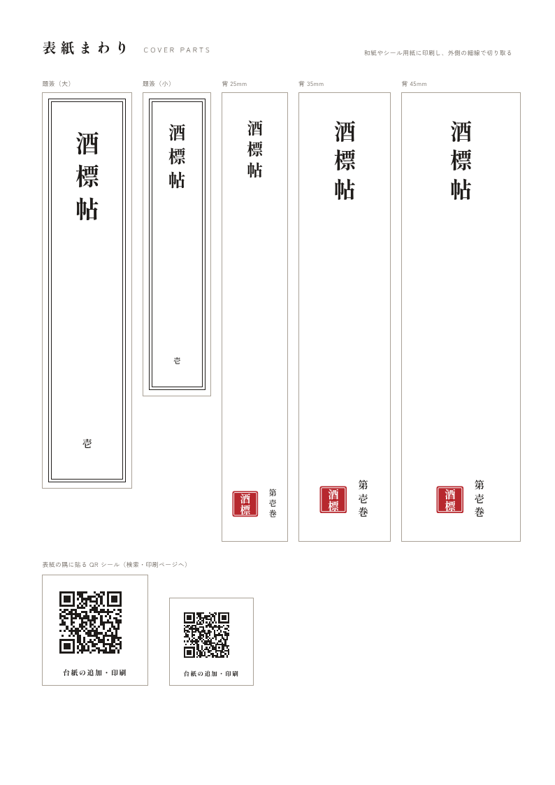
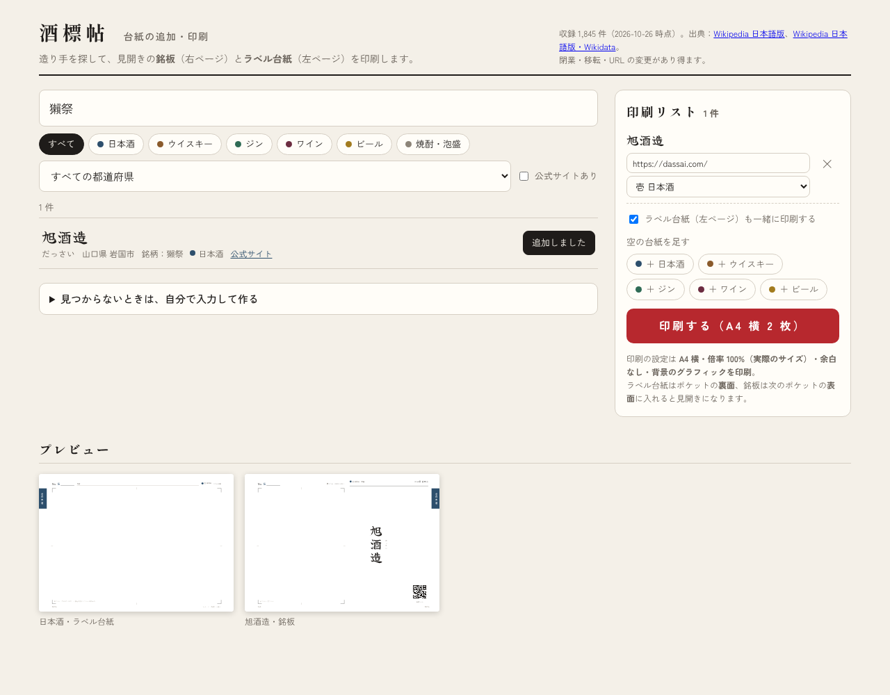

# 酒標帖（しゅひょうちょう）── 見開きで集める酒ラベル帖

日本酒・ウイスキー・ジン・ワイン・ビールの瓶のラベルを、**A4 横の見開き**で綴じていくコレクション帖です。
左ページにラベル、右ページにはその酒の**造り手の名前を楷書で大きく**記した「銘板」。銘板の QR コードを読めば、造り手の公式サイトが開きます。
日本酒好きの友人への誕生日プレゼントとして、手作りで仕上げることを想定しています。



> 以前の「A4 縦・詳しい呑みの記録欄つき」のデザインは、ブランチ [`claude/sake-label-collection-detailed-record`](../../tree/claude/sake-label-collection-detailed-record) に残してあります。

---

## 1. しくみ

| | |
|---|---|
| **一本＝見開きひとつ** | 左ページ（ラベル台紙）に表ラベル、右ページ（銘板）に裏ラベル・肩ラベル。どちらも A4 横で、貼れる枠は左が 258×176mm、右が 132×176mm。 |
| **銘板** | 造り手の名前を楷書体で縦書きに。都道府県・市町村と、公式サイトへの QR コード付き。 |
| **どこに何があるか** | 区分（壱 日本酒・弐 ウイスキー・参 ジン・肆 ワイン・伍 ビール）ごとに小口の**色の爪**。番号は区分ごとの通し番号（S001・W001・G001・V001・B001）で、**目録**に書く。右ページの大きな造り手の名前は、ぱらぱらめくっても目に入る。 |
| **台紙が足りなくなったら** | 表紙の隅と扉の **QR コード**から「台紙の検索・印刷ページ」を開き、造り手を**名前・よみ・都道府県・種類で検索・絞り込み**して、銘板とラベル台紙をその場で印刷できる。一覧に無い造り手は名前と URL を入力して作れる。 |
| **集めたくなる仕掛け** | 全国制覇地図（造り手のいる県を塗る）と道しるべ、節目の番号が朱色の目録、落款（はんこ）。 |

### 見開きとポケット

A4 横のクリアポケット 1 枚には表と裏で 2 ページ入ります。**ラベル台紙を前のポケットの裏面、銘板を次のポケットの表面**に入れると、開いたときに見開きになります（ある酒の銘板と、次の酒のラベル台紙が背中合わせ）。
途中に一本差し込むときは、空のポケットを 1 枚足して、後ろの銘板を 1 つ移すだけです。

---

## 2. ページ一覧

| | | |
|---|---|---|
|  |  |  |
| 扉（左下に検索・印刷ページの QR） | 使い方 | ラベルの剥がし方 |
|  |  |  |
| 全国制覇地図 | 中扉 | 目録 |
|  |  | |
| 空の銘板（手書き用） | 題簽・背ラベル・表紙の QR シール | |

---

## 3. 印刷データ（`print/`）

| ファイル | 内容 | 印刷 |
|---|---|---|
| `01_cover-guide.pdf` | 扉・使い方・剥がし方・全国制覇地図 | A4 横・片面 |
| `02_dividers-index.pdf` | 区分ごとの中扉と目録（日本酒 100 本・ほか各 40 本分） | A4 横・片面 |
| `03_label-sheets.pdf` | ラベル台紙（左ページ）。区分ごとに 1 ページ | A4 横・片面、必要な枚数だけ |
| `04_blank-meiban.pdf` | 空の銘板（右ページ・造り手名を手書きする用）。区分ごとに 1 ページ | A4 横・片面 |
| `05_cover-parts.pdf` | 題簽・背ラベル・表紙の隅に貼る QR シール | A4 縦（和紙・シール用紙） |
| `06_seal-order.pdf` | 落款はんこの入稿原稿 | はんこ店にデータで渡す |
| `bleed/` | 上記の**塗り足し 3mm 付き**版（印刷通販に入稿する場合） | |
| `html/` | ブラウザで開いて印刷もできる HTML 版 | |

印刷は**倍率 100%（実際のサイズ）**で。すべて片面印刷です（見開きはポケットへの入れ方で作るため）。
造り手の名前入りの銘板は、次の「検索・印刷ページ」から印刷します。

---

## 4. 台紙の検索・印刷ページ（`site/`）



- 造り手を**名前・よみ（ひらがな/カタカナどちらでも）・市町村**で検索し、**種類**と**都道府県**、**公式サイトの有無**で絞り込む
- 「＋ 印刷リストへ」で集め、区分（どの色の爪の台紙にするか）を選んで、**銘板とラベル台紙をまとめて印刷**
- 一覧に無い造り手は「自分で入力して作る」から。空の台紙だけを足すこともできる
- 外部の CDN に頼らない静的ファイルだけのページ（フォントのみ Google Fonts）。どこに置いても動きます

手元で試すとき：

```sh
npm install
npm run serve      # http://localhost:8080 で開く
```

**公開先はまだ未定**です。決まったら `templates/config.json` の `siteUrl` に URL を入れて `npm run build` し直すと、扉と表紙シールに QR コードが入ります。

### 造り手の一覧（`data/makers.csv` → `site/makers.json`）

一覧は `data/makers.csv` に 1 行 1 造り手で持ち、`npm run makers` で検索ページ用の `site/makers.json` に変換します。

```csv
name,kana,pref,city,types,url,source
〇〇酒造,まるまるしゅぞう,新潟,〇〇市,sake|shochu,https://example.com/,wikidata
```

- `types` は `sake` `shochu` `whisky` `gin` `wine` `beer` `other` を `|` 区切りで
- 「株式会社」などは自動で外し、同じ名前・同じ都道府県の行は 1 件にまとめます。不明な都道府県・種類・URL は警告します
- `source` は `data/sources.json` に出典名・URL・ライセンスを書いておくと、検索ページに出典として表示されます

### いま入っている一覧（2026-10-26 時点）

2 つの取得元を合わせ、同じ造り手（名前と都道府県が同じ。旧字体の違いは同じとみなす）は 1 件にまとめています。

| 取得元 | スクリプト | 中身 |
|---|---|---|
| Wikipedia 日本語版・Wikidata | `npm run fetch-makers` → `data/makers.csv` | 日本酒メーカー一覧・焼酎メーカー一覧・泡盛の銘柄一覧・ジャパニーズ・ウイスキーの蒸留所一覧・日本のビールメーカー一覧と、ワイン・ジン・ウイスキー・ビールのメーカーのカテゴリ。各記事のよみ・所在地・公式サイト、Wikidata の公式サイト（P856） |
| 国税庁「酒蔵マップ」 | `npm run fetch-nta` → `data/nta.csv`（要 `pip install pdfplumber`） | 仙台国税局の製造者一覧（製造場名・市町村・代表銘柄・ジャンル）と、東京・札幌・金沢・名古屋・高松・福岡・熊本国税局の掲載業者一覧 |

| 種類 | 件数 | うち公式サイトあり |
|---|---:|---:|
| 日本酒 | 1,437 | 1,249 |
| 焼酎・泡盛 | 158 | 154 |
| ウイスキー | 83 | 76 |
| ジン | 15 | 15 |
| ワイン | 251 | 236 |
| ビール | 520 | 499 |
| その他（種類が判別できないもの） | 439 | 359 |
| **合計（重複を除く）** | **2,759** | **2,445** |

国税庁から増えた造り手は 914 件です（残りは Wikipedia の一覧と重なっていました）。
公式サイトは、Wikipedia・Wikidata に載っていた 638 件に加えて、残りの造り手を 1 件ずつウェブ検索して 1,807 件を補いました（`data/urls.csv`、出典は `web`）。検索結果に実際に出てきた URL だけを使い、同じ都道府県の同じ造り手と確かめられないものは空のままです。補った分のうち、自社サイトが無く**親会社のページ**のものが約 130 件、**Facebook・Instagram などの公式アカウント**のものが約 60 件あります。

**分かっている限界**
- 国税庁の酒蔵マップは国税局ごとに形式が違い、**関東信越（茨城・栃木・群馬・埼玉・新潟・長野）・大阪（近畿）・広島（中国）・沖縄は文字で読める一覧が無い**ため入っていません（この地域は Wikipedia の分だけです）。また酒蔵マップ自体が「掲載を希望した製造者」の一覧で、全数ではありません
- 札幌・金沢・名古屋・高松・福岡・熊本の一覧は**製造場名ではなく会社名**なので、銘板に会社名が出ることがあります。種類も名前から推測しており、判別できないものは「その他」です（印刷するときに区分を選べます）
- 公式サイトの URL は Wikipedia の記載とウェブ検索の結果から取っており、**どれも実際にアクセスして確かめてはいません**。古いもの・移転したもの、同名の別の造り手のものが混ざっている可能性があります。検索ページの印刷リストで、印刷前に URL を確かめて直せます
- 公式サイトが見つからなかった造り手が 314 件あります（すべて検索済み）。サイトを持たない小さな蔵も多いです
- アプリなど他サービスのデータベースの複製はしていません

出典：Wikipedia 日本語版（CC BY-SA 4.0）、Wikidata（CC0）、国税庁ホームページ「酒蔵マップ」（各国税局）を加工して作成（公共データ利用規約 第1.0版）。

---

## 5. 設定とデータの作り直し

`templates/config.json`

```jsonc
{
  "title": "酒標帖",
  "volume": "壱",            // 巻数
  "recipient": "",           // 贈る相手の名前（空なら扉は手書き用の線）
  "sealText": "酒標",        // 落款の文字
  "siteUrl": "",             // 検索・印刷ページの公開 URL（扉と表紙シールの QR になる）
  "indexPages": { "sake": 5, "whisky": 2, "gin": 2, "wine": 2, "beer": 2 }  // 目録のページ数（1 ページ 20 本）
}
```

```sh
npm run build          # print/ に PDF と HTML（site/config.json も更新）
npm run build:bleed    # print/bleed/ に塗り足し付き PDF
npm run preview        # docs/images/ のプレビュー画像も更新
npm run fetch-makers   # Wikipedia・Wikidata から data/makers.csv を作る（取得結果は data/.cache/ に保存）
npm run fetch-nta      # 国税庁の酒蔵マップから data/nta.csv を作る（Python と pdfplumber が必要）
npm run makers         # data/makers.csv → site/makers.json
```

ページのデザインは `site/lib/render.js` と `site/lib/sheet.css` にあり、印刷データの生成（Node）と検索・印刷ページ（ブラウザ）で共用しています。区分の色や番号の頭文字は `site/lib/data.js` で変えられます。

フォントは [しっぽり明朝](https://fonts.google.com/specimen/Shippori+Mincho)、[Zen角ゴシック New](https://fonts.google.com/specimen/Zen+Kaku+Gothic+New)、造り手の名前に [Yuji Syuku](https://fonts.google.com/specimen/Yuji+Syuku)（いずれも SIL Open Font License）。QR コードの生成に [qrcode-generator](https://github.com/kazuhikoarase/qrcode-generator)（MIT）を使っています。QR コードは株式会社デンソーウェーブの登録商標です。

作り方・材料・スケジュールは [docs/making-guide.md](docs/making-guide.md) にあります。
