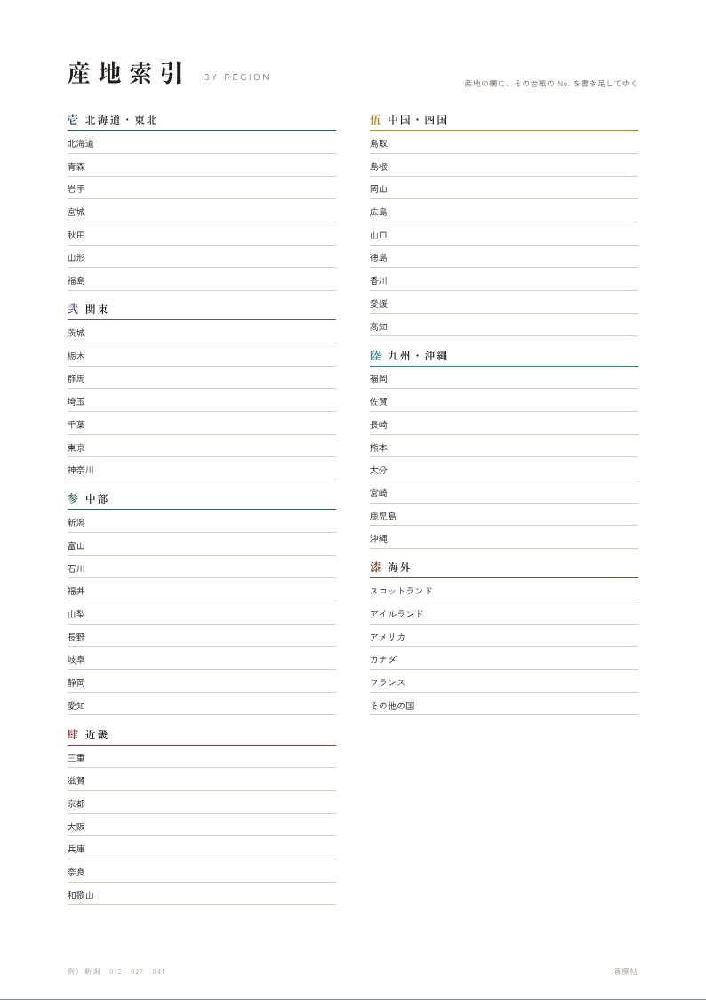
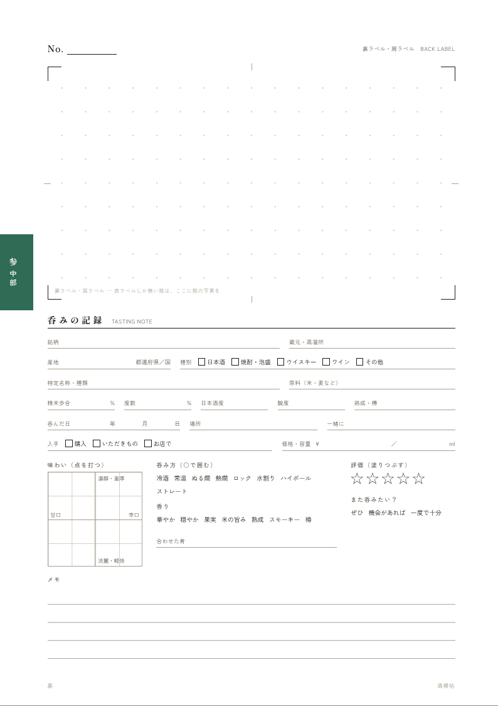

# 酒標帖（しゅひょうちょう）── 酒ラベルを「集めたくなる」ファイリング

日本酒・焼酎・ウイスキーなどの瓶のラベルを、**一本一枚の台紙**に貼って綴じていくコレクション帖です。
市販のラベル帳で物足りなかった点を解決する仕組みを設計し、印刷データ一式を用意しました。
日本酒好きの友人への誕生日プレゼントとして、手作りで仕上げることを想定しています。


---

## 1. 何が物足りなかったか、どう解決するか

| 困りごと | この帖での解決 |
|---|---|
| **どこにどのお酒があるか分からなくなる** | ① 呑んだ順の**通し番号**（No.001〜）を台紙と目録に書く。② バインダーは**産地の区分ごと**（7区分）に分かれ、台紙の小口に**色の爪**が付いているので、閉じたままでも区分が分かる。③ 番号から引く「**目録**」と、産地から引く「**産地索引**」の 2 つの索引がある。 |
| **表と裏で 2 枚あるラベル** | **一本＝台紙一枚**。表面に表ラベル、裏面に裏ラベルと記録。ページをめくると瓶をくるりと回したように裏ラベルが出てくる。 |
| **表だけで横に長いラベル** | 貼る枠は 172×250mm。横長のラベルは**縦向きに貼れば約 25cm まで**入る（四合瓶に巻きつけるラベルはほとんど収まる）。それより長いものは、A3 を二つ折りにする**ワイド台紙**へ。 |
| **貼って終わりで、集める楽しみが薄い** | 下の「集めたくなる仕掛け」を参照。 |

### 集めたくなる仕掛け

- **全国制覇地図** … 呑んだ酒の産地の県を塗りつぶす都道府県タイルマップ。「初めの一県」「十県」「全国制覇」などの**道しるべ**に到達したら印を押す。
- **目録は No.001〜100 が印刷済み** … 空欄が並んでいると埋めたくなる。010・025・050 など**節目の番号は朱色**。
- **呑みの記録** … 銘柄のスペックだけでなく「**誰と・どこで・何を肴に**」を書く欄がある。ラベル帳が思い出帳になる。
- **色の爪が増えていく小口** … 区分ごとに色（藍・江戸紫・常磐・臙脂・山吹・浅葱・琥珀）が違うので、集めるほど小口がカラフルになる。
- **落款（はんこ）** … 帖のシンボルとして朱色の印を用意。はんこを発注すれば、道しるべや記念の一本に押せる。
- **最初の数ページは埋めてから贈る** … 白紙のアルバムより、2〜3 本埋まっている方が続けたくなる（制作ガイド参照）。

---

## 2. 構成

A4 のバインダーに、A4 のクリアポケットで台紙を綴じる構成です。ポケットに入れるのでラベルが傷まず、台紙は何枚でも差し込んだり並べ替えたりできます。

```
扉 ─ 贈る言葉 ─ 使い方 ─ ラベルの剥がし方
全国制覇地図 ─ 産地索引 ─ 目録（001〜100）
中扉 壱 北海道・東北 ─ 台紙…
中扉 弐 関東        ─ 台紙…
中扉 参 中部        ─ 台紙…
中扉 肆 近畿        ─ 台紙…
中扉 伍 中国・四国  ─ 台紙…
中扉 陸 九州・沖縄  ─ 台紙…
中扉 漆 海外        ─ 台紙…（スコッチ、バーボンなど）
```

| | | |
|---|---|---|
|  |  |  |
| 扉 | 使い方 | ラベルの剥がし方 |
|  |  |  |
| 全国制覇地図 | 産地索引 | 目録 |
|  |  |  |
| 中扉 | 台紙の裏（裏ラベル＋呑みの記録） | 題簽・背ラベル・落款 |

ワイド台紙（A3 二つ折り）:


---

## 3. 印刷データ（`print/`）

| ファイル | 内容 | 印刷 |
|---|---|---|
| `01_cover-guide.pdf` | 扉・贈る言葉・使い方・ラベルの剥がし方（4 頁） | A4 片面 |
| `02_index-map.pdf` | 全国制覇地図・産地索引・目録 ×4（6 頁） | A4 片面 |
| `03_dividers.pdf` | 中扉 ×7 | A4 片面 |
| `04_sheet_0_common.pdf` | 台紙（共通・爪なし）×4 枚 | **A4 両面・長辺とじ** |
| `04_sheet_1_tohoku.pdf` 〜 `04_sheet_7_abroad.pdf` | 区分ごとの台紙（爪の色と位置が区分ごとに違う）×4 枚ずつ | **A4 両面・長辺とじ** |
| `05_wide-sheet_A3.pdf` | ワイド台紙 | A3 片面 |
| `06_cover-parts.pdf` | 題簽（表紙に貼る題）・背ラベル・落款の原稿 | A4（和紙推奨） |
| `bleed/` | 上記の**塗り足し 3mm 付き**版（印刷通販に入稿する場合） | |
| `html/` | ブラウザで開いて印刷もできる HTML 版 | |

印刷するときは**倍率 100%（実際のサイズ）**で。家庭用プリンターは紙の端まで印刷できないため、爪（色帯）の外側が数 mm 欠けますが、使ううえでは問題ありません。端までくっきり出したい場合は `bleed/` 版を印刷所に入稿してください。

**作り方・材料・発注先・スケジュールは [docs/making-guide.md](docs/making-guide.md) にまとめています。**

---

## 4. 名前を入れてデータを作り直す

印刷データの名前欄は空欄（手書き用）になっています。贈る相手の名前を印字したい場合:

1. `templates/config.json` を編集する

   ```jsonc
   {
     "recipient": "山田 太郎",       // 扉・背ラベル・各頁の隅に入る名前（「〇〇 蔵」と表示）
     "giver": "あなたの名前",         // 贈る言葉のページの差出人
     "presentedOn": "二〇二六年 十一月", // 贈る言葉のページの日付
     "volume": "壱",                 // 巻数（2冊目なら「弐」）
     "sealText": "酒標",             // 落款の文字（2文字か4文字。名前の一字を入れても良い）
     "sheetsPerRegion": 4            // 区分ごとの台紙PDFに入れる枚数
   }
   ```

2. 生成する（Node.js 18 以上）

   ```sh
   npm install
   npm run build          # print/ に PDF と HTML を出力
   npm run build:bleed    # print/bleed/ に塗り足し付き PDF を出力
   npm run preview        # docs/images/ のプレビュー画像も更新
   ```

フォントは [しっぽり明朝](https://fonts.google.com/specimen/Shippori+Mincho) と [Zen角ゴシック New](https://fonts.google.com/specimen/Zen+Kaku+Gothic+New)（どちらも SIL Open Font License）を使っています。PC にインストールしておくか、ネットにつながった状態で生成してください。

区分の色や都道府県タイルの配置は `templates/regions.mjs`、各ページのデザインは `templates/build.mjs` と `templates/styles.css` で変更できます。
