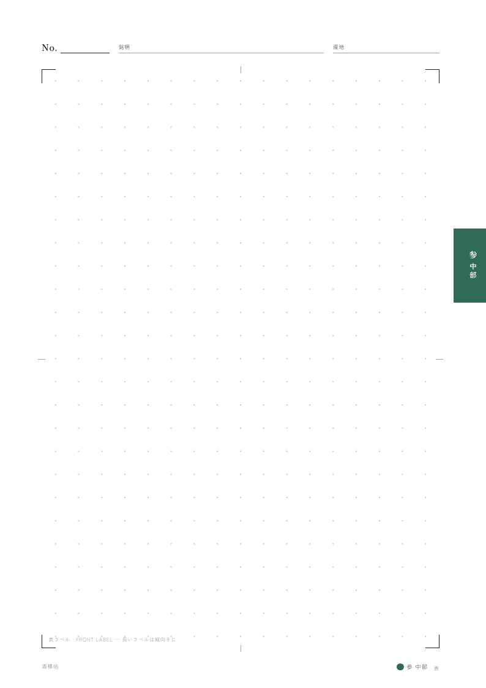
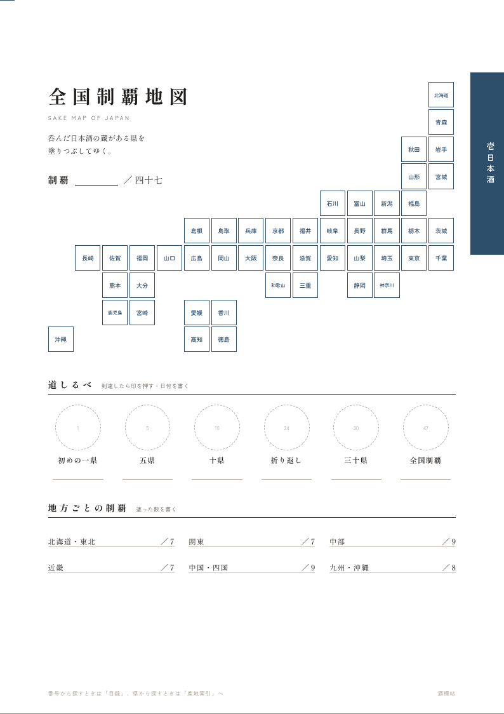
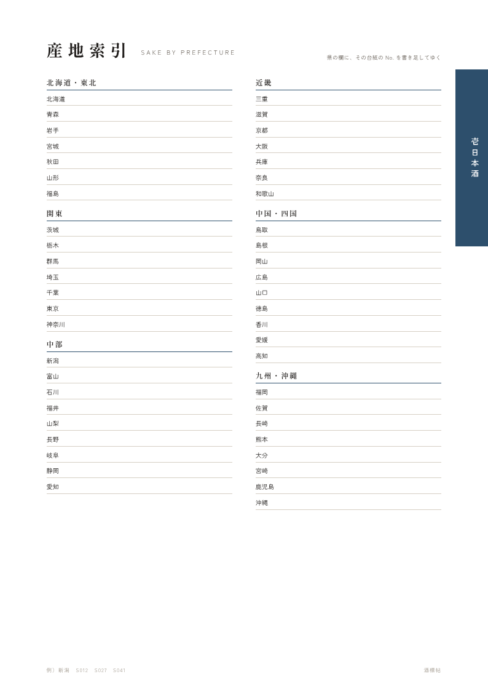
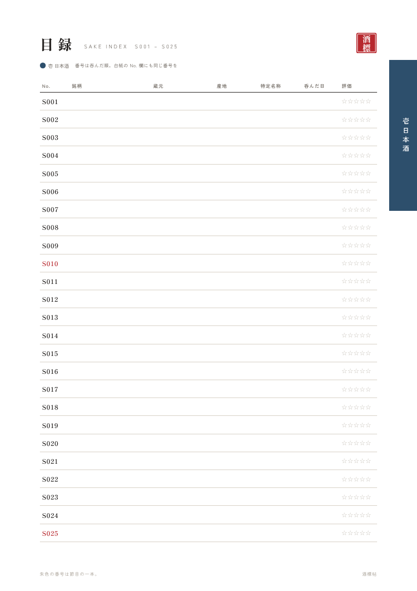
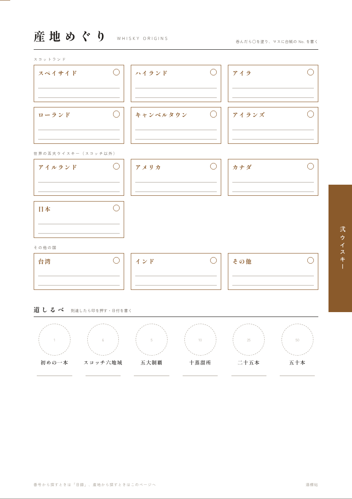
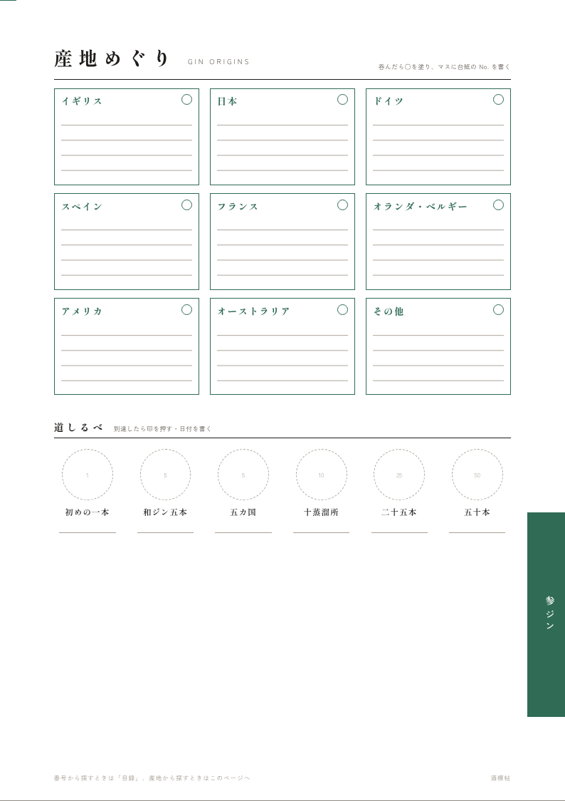
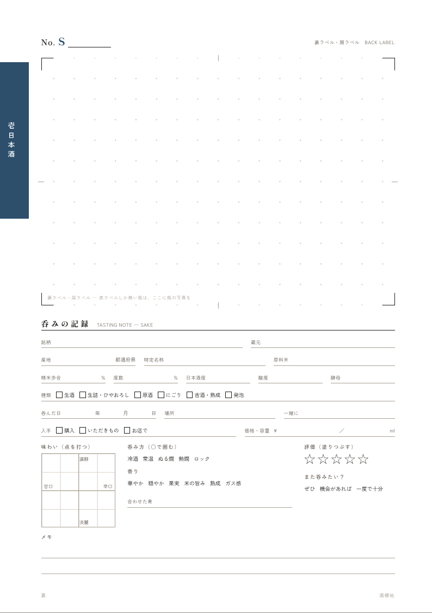
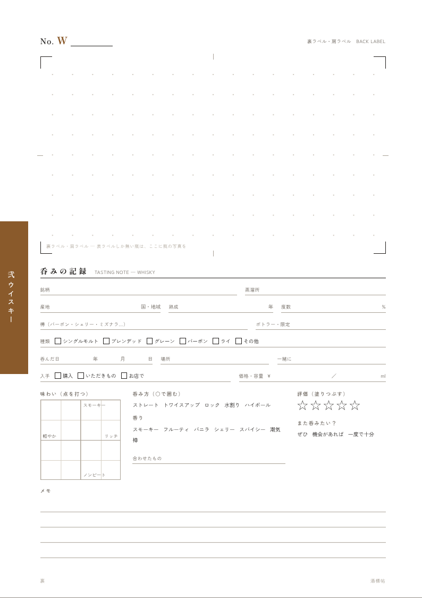
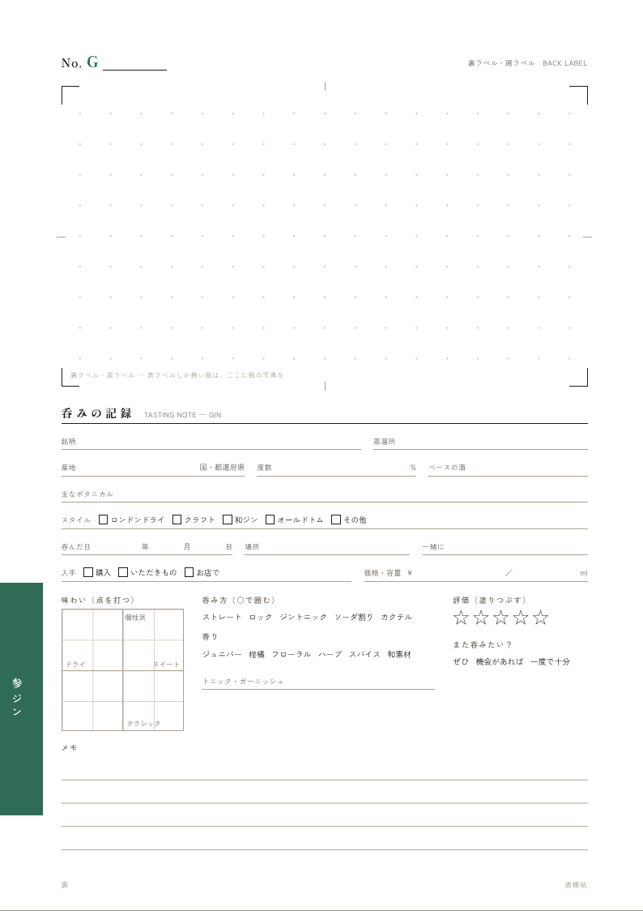
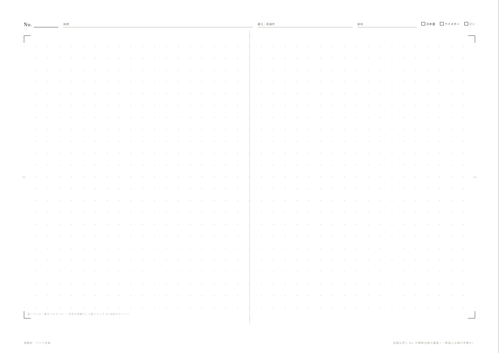

# 酒標帖（しゅひょうちょう）── 酒ラベルを「集めたくなる」ファイリング

**日本酒・ウイスキー・ジン**の瓶のラベルを、**一本一枚の台紙**に貼って綴じていくコレクション帖です。
市販のラベル帳で物足りなかった点を解決する仕組みを設計し、印刷データ一式を用意しました。
日本酒好きの友人への誕生日プレゼントとして、手作りで仕上げることを想定しています。



---

## 1. 何が物足りなかったか、どう解決するか

| 困りごと | この帖での解決 |
|---|---|
| **どこにどのお酒があるか分からなくなる** | ① 帖は**日本酒・ウイスキー・ジンの 3 区分**に分かれ、台紙の小口に区分ごとの**色の爪**（藍・琥珀・常磐）が付いているので、閉じたままでも開きたい種類が分かる。② 番号は**種類ごとの通し番号**（日本酒 S001〜、ウイスキー W001〜、ジン G001〜）で、台紙と目録の両方に書く。③ 番号から引く「**目録**」と、産地から引く索引（日本酒は「**産地索引**」、ウイスキー・ジンは「**産地めぐり**」）がある。 |
| **表と裏で 2 枚あるラベル** | **一本＝台紙一枚**。表面に表ラベル（枠 172×250mm）、裏面に裏ラベル（枠 172×120mm。一升瓶の裏ラベルも横向きなら入る）と記録。ページをめくると瓶をくるりと回したように裏ラベルが出てくる。 |
| **表だけで横に長いラベル** | 貼る枠は 172×250mm。横長のラベルは**縦向きに貼れば約 25cm まで**入る（四合瓶に巻きつけるラベルはほとんど収まる）。それより長いものは、A3 を二つ折りにする**ワイド台紙**へ。 |
| **貼って終わりで、集める楽しみが薄い** | 下の「集めたくなる仕掛け」を参照。 |

### 集めたくなる仕掛け

- **日本酒は全国制覇地図** … 呑んだ日本酒の蔵がある県を塗りつぶす都道府県タイルマップ。「初めの一県」「十県」「全国制覇」などの**道しるべ**に到達したら印を押す。
- **ウイスキー・ジンは産地めぐり** … 産地ごとのマスを塗り、台紙の No. を書き込む。ウイスキーは「スコッチ六地域」「世界の五大ウイスキー制覇」、ジンは「和ジン五本」「五カ国」などの道しるべ付き。
- **目録の番号は印刷済み** … 日本酒は S001〜100、ウイスキー・ジンは 001〜050。空欄が並んでいると埋めたくなる。010・025・050 など**節目の番号は朱色**。
- **種類ごとの呑みの記録** … 日本酒は精米歩合・日本酒度・燗の具合、ウイスキーは熟成年数・樽・ピート、ジンはボタニカル・トニック。どれにも「**誰と・どこで**」を書く欄があり、ラベル帳が思い出帳になる。
- **落款（はんこ）** … 帖のシンボルとして朱色の印を用意。はんこを発注すれば、道しるべや記念の一本に押せる。
- **最初の数ページは埋めてから贈る** … 白紙のアルバムより、2〜3 本埋まっている方が続けたくなる（制作ガイド参照）。

---

## 2. 構成

A4 のバインダーに、A4 のクリアポケットで台紙を綴じる構成です。ポケットに入れるのでラベルが傷まず、台紙は何枚でも差し込んだり並べ替えたりできます。

```
扉 ─ 贈る言葉 ─ 使い方 ─ ラベルの剥がし方
壱 日本酒      中扉 ─ 全国制覇地図 ─ 産地索引 ─ 目録 S001〜100 ─ 台紙…
弐 ウイスキー  中扉 ─ 産地めぐり ─ 目録 W001〜050 ─ 台紙…
参 ジン        中扉 ─ 産地めぐり ─ 目録 G001〜050 ─ 台紙…
巻末          ワイド台紙・空きポケット
```

各区分は中扉から台紙までで完結しているので、数が増えたら**種類ごとに別のバインダーへ分冊**することもできます（その場合は題簽の巻数を変えて作り直す）。

| | | |
|---|---|---|
|  |  |  |
| 扉 | 使い方 | ラベルの剥がし方 |
|  |  |  |
| 中扉（日本酒） | 全国制覇地図（日本酒） | 産地索引（日本酒） |
|  |  |  |
| 目録（日本酒） | 産地めぐり（ウイスキー） | 産地めぐり（ジン） |
|  |  |  |
| 台紙の裏（日本酒） | 台紙の裏（ウイスキー） | 台紙の裏（ジン） |

ワイド台紙（A3 二つ折り）と、題簽・背ラベル・落款:




---

## 3. 印刷データ（`print/`）

| ファイル | 内容 | 印刷 |
|---|---|---|
| `01_cover-guide.pdf` | 扉・贈る言葉・使い方・ラベルの剥がし方（4 頁） | A4 片面 |
| `02a_sake_index.pdf` | 日本酒：中扉・全国制覇地図・産地索引・目録 ×4（7 頁） | A4 片面 |
| `02b_sake_sheets.pdf` | 日本酒の台紙 ×4 枚 | **A4 両面・長辺とじ** |
| `03a_whisky_index.pdf` | ウイスキー：中扉・産地めぐり・目録 ×2（4 頁） | A4 片面 |
| `03b_whisky_sheets.pdf` | ウイスキーの台紙 ×4 枚 | **A4 両面・長辺とじ** |
| `04a_gin_index.pdf` | ジン：中扉・産地めぐり・目録 ×2（4 頁） | A4 片面 |
| `04b_gin_sheets.pdf` | ジンの台紙 ×4 枚 | **A4 両面・長辺とじ** |
| `05_wide-sheet_A3.pdf` | ワイド台紙（種類は ✓ で選ぶ） | A3 片面 |
| `06_cover-parts.pdf` | 題簽（表紙に貼る題）・背ラベル・落款の原稿 | A4（和紙推奨） |
| `07_seal-order.pdf` | 落款はんこの入稿原稿（拡大図と実寸） | はんこ店にデータで渡す |
| `bleed/` | 上記の**塗り足し 3mm 付き**版（印刷通販に入稿する場合） | |
| `bleed/order_A4_single-sided.pdf`<br>`bleed/order_A4_double-sided.pdf` | 入稿用にまとめたもの。片面もの 19 頁と、台紙 40 枚（日本酒 24・ウイスキー 8・ジン 8） | 片面／両面 |
| `html/` | ブラウザで開いて印刷もできる HTML 版 | |

台紙の PDF は 4 枚分なので、必要な枚数になるまで部数を増やして印刷します。
印刷するときは**倍率 100%（実際のサイズ）**で。家庭用プリンターは紙の端まで印刷できないため、爪（色帯）の外側が数 mm 欠けますが、使ううえでは問題ありません。端までくっきり出したい場合は `bleed/` 版を印刷所に入稿してください。

**作り方・材料・発注先・スケジュールは [docs/making-guide.md](docs/making-guide.md)、今やることの段取りは [docs/next-steps.md](docs/next-steps.md) にまとめています。**

---

## 4. 名前を入れてデータを作り直す

印刷データの名前欄は空欄（手書き用）になっています。贈る相手の名前を印字したい場合:

1. `templates/config.json` を編集する

   ```jsonc
   {
     "recipient": "山田 太郎",       // 扉・背ラベル・各頁の隅に入る名前（「〇〇 蔵」と表示）
     "giver": "あなたの名前",         // 贈る言葉のページの差出人
     "presentedOn": "二〇二六年 十一月", // 贈る言葉のページの日付
     "volume": "壱",                 // 巻数（2冊目なら「弐」）
     "sealText": "酒標",             // 落款の文字（2文字か4文字。名前の一字を入れても良い）
     "indexPages": { "sake": 4, "whisky": 2, "gin": 2 }, // 目録のページ数（1ページ25本）
     "sheetsPerType": 4              // 台紙PDF 1部あたりの枚数
   }
   ```

2. 生成する（Node.js 18 以上）

   ```sh
   npm install
   npm run build          # print/ に PDF と HTML を出力
   npm run build:bleed    # print/bleed/ に塗り足し付き PDF を出力
   npm run preview        # docs/images/ のプレビュー画像も更新
   ```

フォントは [しっぽり明朝](https://fonts.google.com/specimen/Shippori+Mincho) と [Zen角ゴシック New](https://fonts.google.com/specimen/Zen+Kaku+Gothic+New)（どちらも SIL Open Font License）を使っています。PC にインストールしておくか、ネットにつながった状態で生成してください。

区分（種類）の色・番号の頭文字・記録欄の選択肢・産地めぐりのマスは `templates/data.mjs`、各ページのデザインは `templates/build.mjs` と `templates/styles.css` で変更できます。
